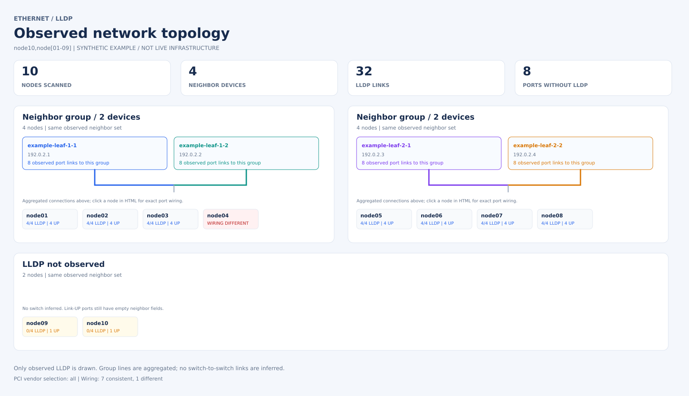

# Etherlink

Linux 以太网口与 LLDP 拓扑工具，Python 3.9+ 标准库实现，无 pip 依赖。
控制端需要 OpenSSH；节点需要 Python 3.9+、已有 lldpd 服务和可访问的 lldpcli。
默认选择 Mellanox 网卡（PCI 0x15b3）。不安装软件、不改网卡或交换机配置；UP 物理口无 LLDP 时默认自动尝试一次服务恢复。

## 最简单的用法

```bash
cd /home/cmsupport/workspace/etherlink
./etherlink-cli 'node[01-08]'
./etherlink-cli 'node[01-08]' --html topology.html
```

第一条查看控制台，第二条另存可交互报告。默认选择 Mellanox，自动执行必要的一次 LLDP
恢复和同组接法检查；无需重复指定默认参数。其他参数见 ./etherlink-cli --help。

集合加引号，支持范围、枚举和多组括号；默认最多展开 4096 个节点，展开后去重。
--nodes-file 每行接受一个名字或集合，允许空行和 # 注释。
默认最多并行处理 100 台节点，可用 --workers 指定 1 到 128。
SSH 复用已有配置，不交互询问密码、不关闭主机密钥校验。local 表示本机。

## 独立名字工具

```bash
/home/cmsupport/workspace/etherlink/etherlink/hosts.py 'node[001-003,007]'
/home/cmsupport/workspace/etherlink/etherlink/hosts.py -c node001 node002 node003 node007
/home/cmsupport/workspace/etherlink/etherlink/hosts.py -c 'node[001-003]' node007
/home/cmsupport/workspace/etherlink/etherlink/hosts.py --separator ',' 'gpu[01-04]'
/home/cmsupport/workspace/etherlink/etherlink/hosts.py -c < names.txt
```

默认逐行展开；--expand/-e 展开，--compact/-c 合并为 node[001-003,007]。
无参数或参数为 - 时读取标准输入，空白分隔，不处理 # 注释。
合并最后一段数字，按前后缀及补零规则分组；结果排序去重，不补出不存在的节点。
不保证最短表达式。主工具无单独名字处理模式，仅自动展开输入集合。


## 输出和限制

SVG 是图片，可用浏览器打开，无 Graphviz/绘图库依赖；当前不直接输出 PNG。
JSON 保留错误及邻居详细字段；CSV 一行一个网口/邻居组合，无邻居时交换机字段为空。
--input 使用保存的 JSON 重绘，不联网。输出覆盖同名文件。
现场报告在 reports/，不要提交到公共仓库。

默认枚举 sysfs 中 type=1 且有 device 的网口，包含 bond 物理成员、RoCE；
排除虚拟网口和原生 InfiniBand。VF 用 is_vf 标记。
--include-virtual 包含虚拟以太网口，不猜测 bond 邻居属于哪个成员。
速率单位 Mb/s，无法读取为 null。

读取 lldpcli -f json show neighbors details，仅采纳 LLDP。多个邻居全部保留。
按 Chassis ID 分组，缺失时用系统名和管理地址；邻居不一定是交换机。
age 不代表最后收包时间。无 LLDP 不等于断线；权限不足、命令缺失、SSH 失败单独报告。
不自动抓包或尝试 lldptool。BMC 口只有 Linux 可见时才能发现。

退出码：0 成功（允许无邻居）；1 部分采集错误，仍导出结果；2 参数/文件/格式错误。

## 检查

```bash
python3 -m unittest discover -s tests -v
python3 -m compileall -q etherlink
```

## 示例图

以下为模拟数据，不对应现场设备：



保存的数据样例见 examples/demo.json。

## 网卡厂商选择与可交互拓扑

```bash
./etherlink-cli 'node[001-016]' --html topology.html --svg overview.svg
./etherlink-cli 'node[001-016]' --vendor mellanox,intel
./etherlink-cli 'node[001-016]' --vendor mellanox --vendor broadcom
./etherlink-cli 'node[001-016]' --vendor all
./etherlink-cli 'node[001-016]' --vendor all --driver mlx5_core
./etherlink-cli --input links.json --vendor all --html topology.html
```

--vendor 支持逗号分隔和重复参数，也接受 PCI 厂商 ID，例如 15b3、0x8086。
预设名称：mellanox（nvidia 为同一以太网厂商 ID 的别名）、intel、broadcom、realtek、amazon。
all 取消厂商限制；默认仍排除虚拟设备，需要时另加 --include-virtual。
--driver 为可选驱动白名单，可重复。网卡型号从节点已有 pci.ids 读取，无该数据库时
仍保留 vendor_id、device_id 和驱动，不根据网口名字猜型号。

JSON/CSV/SVG/HTML 均使用筛选后的网口。没有匹配网卡的节点仍保留。
若以后需要切换厂商，请先用 --vendor all 保存完整 JSON；
筛选后的文件无法恢复被排除的网口。旧 JSON 无厂商元数据时，请重新采集，
或使用 --vendor all 绕过筛选，不把未知硬件当成 Mellanox。

多节点 SVG 是按相同邻居集合分组的总览，连线表示聚合连接数，不推断交换机互联。
单节点 SVG 按本地网口自然顺序显示精确接线，不按交换机归属重新排列网口。--html 输出无需服务器和外部资源的单文件报告：
总览中的节点可点击，明细可展开查看端口接线图和硬件字段，搜索支持节点、网口、交换机和型号。
UP 只表示本地链路状态；彩色连线按邻居区分，不代表 LLDP 一定可用；邻居为空仍保留，UP 但无邻居的节点以黄色强调。
PNG 预览可用已有 ImageMagick 将 SVG 转换，核心工具无需安装它。

## LLDP 一次性自动恢复与链路状态

实时采集时，只对所选物理网口中 operstate=up、carrier=1 且无 LLDP 的节点，
自动执行一次 systemctl --no-ask-password restart lldpd.service。
同一节点多个口缺少邻居，也只重启一次；统一等待 5 秒后只复查一次。
仍为空就保留空字段并标注告警，不继续重启或轮询。

DOWN 网口无邻居为正常情况，不触发恢复，不标为 LLDP 异常。
虚拟网口、VF 不触发物理口恢复。重启失败、复查失败分别记录；
JSON 的 lldp_recovery 保存操作结果和恢复前后的缺失网口。
非 root 的服务恢复使用 sudo -n，不交互询问密码；--sudo 仍控制 lldpcli 查询权限。

普通实时采集默认启用上述行为，无需额外参数。
需要纯只读采集时可用 --no-restart-lldp；--input 离线重绘始终不连接节点或重启服务。
该规则不把物理口 UP 当成 LLDP 一定可达的保证；BF3/DPU 等环境恢复后仍缺失时保留待核实，
不自动修改 DPU 模式、转发规则、交换机配置或重置网卡。

单节点图逐口显示 UP/DOWN 和速率；DOWN 以灰色标注，LLDP 空值注明正常。
UP 但无邻居以黄色提示。本地网口按自然顺序固定排列，例如 eth1、eth2、eth10；
没有邻居的网口也保留原位置，右侧连线跟随该位置，总览的分组方式不变。

## 同组接法一致性

默认检查，不用额外开关。依据所选网口实际观察到的交换机身份集合分组，比较
“本地网口名 → 交换机”。另有机柜槽位检查，用于核对下文所述的双上联交换机端口。
优先使用 Chassis ID 区分交换机，不仅看系统名称。

网口名称和数量相同、链路及 LLDP 完整的节点参与投票。
只有超过半数且至少两台支持的模式才作为参考；并列或仅有一台时明确标记参考不足。
网口配置不同单列；DOWN、LLDP 缺失、多邻居及采集错误归为信息不完整，不当成接错。

控制台显示参考和逐口差异；HTML 增加差异表，总览标红不一致节点，明细标红对应网口。
JSON 保存 wiring_check 和每台 wiring；CSV 增加 wiring_group、wiring_status、
expected_switch、expected_chassis_id 和 expected_switch_port，在差异网口填写参考身份或端口。
采集退出码规则不变；自动化可读取 wiring_check.summary.mismatch。

GB300 双上联槽位检查使用 `<机柜>-gpu-cp-<槽号>` 和 `swp<N>s<0|1>` 的命名。
按机柜、交换机 Chassis ID 对及本地网口映射分组，从两条物理连接均 UP、每口仅有一个
LLDP 邻居且端口号可解析的节点推断两侧各自的槽位映射。至少 5 台且至少 70% 支持
同一映射才报告疑似错接。`swp11s0` 和 `swp11s1` 是不同的子口。
控制台和 HTML 显示参考票数，JSON 的 `slot_checked` 和 `slot_mismatch` 记录覆盖量和疑似节点数。
现场换线前应对照接线表核实推断端口。

一致不等于布线一定正确，组内多数不是预先批准的接线规范。
观察到的交换机集合不同就分组检查，不猜测节点本来属于哪组；
把线接到别组交换机的情况可能表现为新组或参考不足，需要结合预期拓扑复核。
网口命名不同也不会按位置强行匹配。离线输入同样支持检查，始终不访问节点。
